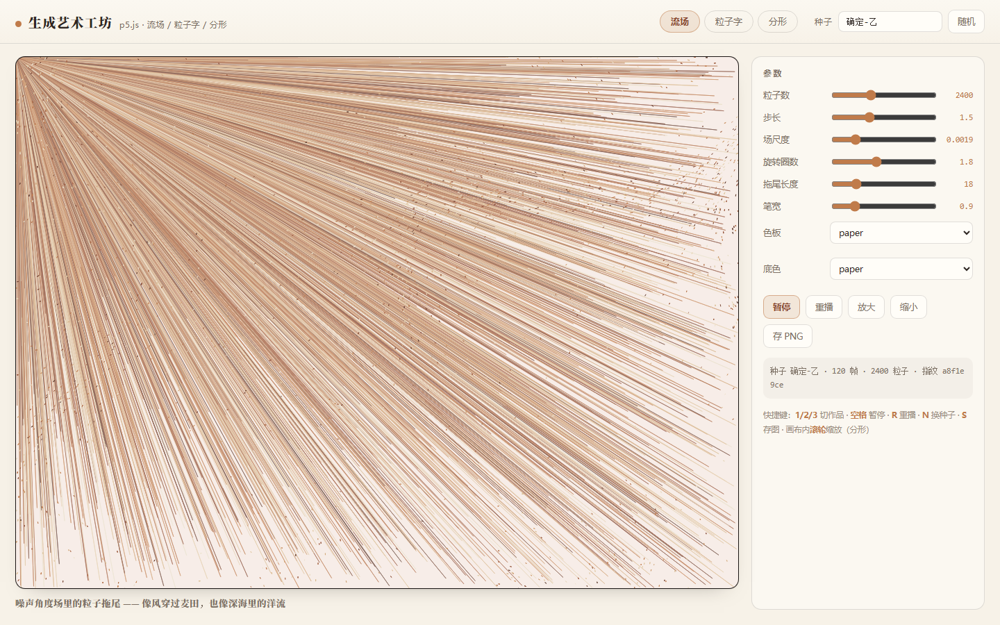
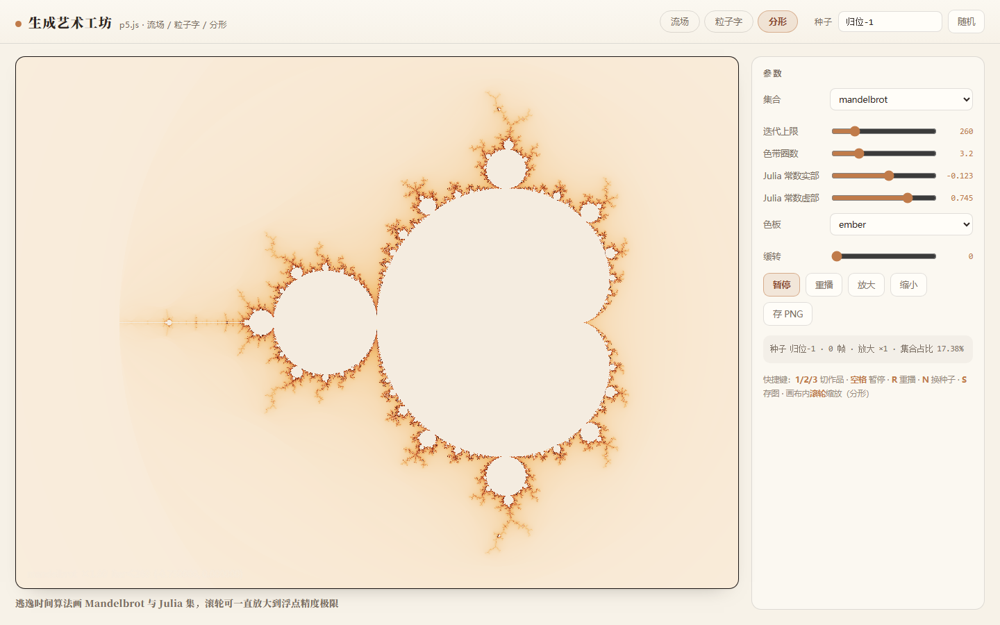

# 生成艺术工坊 · generative-art

> 三个原创生成艺术作品：**流场**、**粒子字**、**分形**。零 CDN 依赖、断网可跑、同一种子必然画出同一张图。
>
> 技术栈：p5.js（本地化）+ 手写纯函数核心库（柏林噪声 / 流场 / 文字掩膜 / 逃逸时间 / 色带）+ Node 单测 + 无头浏览器像素级验证。




---

## 一、这是什么

一个"生成艺术"三连作画廊。左侧画布，右侧实时调参，顶部切换作品、输入种子。

| 作品 | 一句话 | 默认看什么 |
|---|---|---|
| **流场** flowfield | 噪声角度场里的粒子拖尾 | 像风穿过麦田，也像深海洋流；2400 个粒子沿场流动，出界/寿终后从边缘重生 |
| **粒子字** particletext | 把文字拆成目标点，粒子从画面外飞回来排队 | 前 ~60 帧是散乱的点，之后逐渐"归位"成一行字；`密度` 决定字体粗细质感 |
| **分形** fractal | 逃逸时间算法画 Mandelbrot 与 Julia 集 | 滚轮可一直放大；左下角实时显示放大倍数与复平面坐标 |

**三件作品都遵守同一条纪律：同一个种子 → 同一张图。** 这也是全项目的验证基础。

## 二、功能

- **种子系统**：顶部输入框（文本种子，如 `苔-4821`）、`随机` 按钮、快捷键 `N`。改种子 → 引擎从 0 帧重新演化，画面完全不同。
- **实时参数面板**：每个作品 6~8 个参数（粒子数 / 步长 / 场尺度 / 旋转圈数 / 拖尾长度 / 笔宽 / 色板 / 底色 / 采样密度 / 归位弹性 / 阻尼 / 游移 / 迭代上限 / 色带圈数 / Julia 常数 / 集合类型），拖动即生效。
- **暂停 / 重播**：按钮或空格键；`R` 重播。
- **导出 PNG**：`存 PNG` 按钮或 `S` 键。
- **缩放**：分形支持画布内滚轮缩放（以鼠标位置为中心，缩放后重算）、`放大` / `缩小` 按钮。
- **窄屏自适应**：<1080px 时侧栏折到下方，画布按容器重排（有验证断言）。
- **离线性**：p5.js 已本地化到 `vendor/`，页面加载期间**没有任何外部网络请求**（有验证断言）。

## 三、技术实现

```
index.html           画廊外壳（暖纸极简风）
css/style.css        米色底 / 衬线标题 / 克制边框
vendor/p5.min.js     p5.js v1.11.3（本地化，1.03MB）
js/lib/              纯函数核心库（Node 里可直接测）
  rng.js             mulberry32 种子随机 + deriveSeed 子种子派生
  noise.js           手写 2D 柏林噪声（置换表 + 五次插值 + fbm）
  flowfield.js       角度场 / 旋度场 / 粒子推进 / 出界回收
  textmask.js        文字掩膜取点 → 目标点 → 扫描式配对
  raster.js          浏览器端文字栅格化（唯一碰 DOM 的一层）
  fractal.js         逃逸时间算法 / 平滑着色 / 视图↔复平面映射
  palette.js         四套暖色色板 + 色带插值 + 明暗
js/sketches/         三个作品引擎（只维护状态，不碰像素）
js/main.js           p5 装配、控件面板、window.__gen 验证 API
tools/               serve.mjs / core.test.mjs / verify.mjs
qa-shots/verify/     验证脚本产出的实况截图
```

**分层原则：引擎算状态，p5 画像素。** 三个 sketch 引擎都是 `step(n)` + `draw(p)` 的纯状态机——引擎可以在 Node 里用桩 `p5` 直接跑测试，像素层才交给浏览器。这让"逻辑正确"和"画面正确"能被分别证明。

几处具体做法：

- **流场**：`angle = noise01(x·scale, y·scale) · 2π · turns`，粒子按该角度步进；另实现了无散度旋度场 `F = (∂n/∂y, −∂n/∂x)`（粒子不会挤成一坨）。拖尾用"每帧半透明铺底"实现，长度由 `拖尾长度` 参数换算成覆盖透明度（`255/trail`，夹在 3~90）。
- **粒子字**：`fillText` 到离屏 canvas → 读 alpha → 按 `stride` 采样成目标点 → 按 `x·0.77+y·1.31` 投影排序做**扫描式配对**（比随机配对稳定得多，粒子不会互相穿线）→ 弹簧 + 阻尼 + 随时间衰减的噪声游移归位。长句子会自动缩字号以铺满画布。
- **分形**：`z ← z² + c` 逃逸时间，逃逸步数做 log-log 平滑（消除色带"洋葱圈"断层）；渲染按行分块（每帧若干行）—— 既能渐进显示不断帧，又能 `renderAll()` 一次性算完供验证脚本使用；放大时迭代上限按 `log2(3.5/span)·45` 自动提升。
- **确定性**：`p.pixelDensity(1)` + `noLoop()` + 自建单条 rAF 驱动链 + 帧计数器驱动的虚拟时间，保证同种子跨机器像素可比。

## 四、创新点 / 相对参考项目做了什么

参考项目是 **p5.js**（创意编码的行业标准库）。我复刻它的"sketch 生命周期 + 实例模式 + 噪声/粒子/画布 API 用法"，但有四点不同：

1. **把随机性钉死**。p5 的 `random()`/`noise()` 用全局种子且不保证跨平台一致；本项目所有随机都走自己的 `mulberry32 + deriveSeed`，噪声也是手写的柏林噪声——同一种子在任何机器上都画出同一张图，且能在 Node 里断言。
2. **引擎与渲染分离**。p5 习惯把状态塞进 sketch 全局变量；这里引擎是独立模块（`create({width,height,params,seed})` 返回 `step/draw/stats`），因此能用桩 p5 做单元测试，"归位率 100%"、"平均偏差 0.04px"这类指标是算出来的，不是看出来的。
3. **像素级验证**。不走"截图看着对"，而是 `getImageData` 统计（色数、非底色占比、均值、指纹）+ 数学真值交叉验证——例如用 320×240 网格实测 Mandelbrot 集合面积占比，与已知面积 1.50659 对比。
4. **分形把数学正确和视觉正确分开处理**：默认 Julia 常数换成 Douady 兔子（c ≈ −0.123+0.745i）。经典的 −0.4+0.6i 得到的是"树枝状"集合、面积为 0——数学上没错，但画面上只有细线。

## 五、怎么用

```bash
# 起本地服务（零依赖）
node tools/serve.mjs 4183        # 打开 http://127.0.0.1:4183/

# 逻辑单测：132 条断言 / 15 个用例块
node --test tools/core.test.mjs

# 无头浏览器硬验证：52 项断言（需先起服务）
node tools/verify.mjs
```

浏览器里：

- `1` / `2` / `3` 切作品，`空格` 暂停，`R` 重播，`N` 换种子，`S` 存图
- 右侧拖参数即时生效；分形画布内滚轮缩放
- 想复现别人的图：把种子填进去，参数对齐即可

## 六、验证证据（可复跑）

| 项目 | 结果 |
|---|---|
| Node 单测 `tools/core.test.mjs` | **15/15 用例块全绿，132 条断言**，含数学真值：Mandelbrot 面积 ≈ 1.5066、柏林噪声值域与连续性、粒子单步位移 = 步长、配对完整性 |
| 无头浏览器 `tools/verify.mjs` | **52/52 全绿**：0 console 错误、0 未捕获异常、**0 外部请求（完全离线）**、4 张实况截图 |
| 确定性 | 同种子两次重播：引擎指纹一致 + 画面像素指纹一致；换种子：指纹必然改变 |
| 画布真值 | 流场 95 色 / 非底色 74.8%；粒子字 73 色；分形 80 色（5bit 量化）/ 非底色 72.4% |
| 分形数学 | 默认视图集合占比实测 17.38%（理论 1.50659 / 视图面积） |
| 交互 | 走真实 DOM 事件（点击标签、拖滑块、点按钮、敲键盘），不是只调 API |

## 七、已知边界

- 分形在超大迭代上限（1200+）且浅放大时，整幅渲染在无 GPU 的无头环境下要几秒——所以做成按行分块渐进渲染。
- 粒子字的字形依赖系统衬线字体（宋体/SimSun 等），换机器字形略有差异；`密度` 与 `字号自适应` 保证了不同尺寸下都能铺满。
- 拖尾是"历史相关"媒介：像素结果依赖"画了多少帧"，所以重播验证必须走完全相同的调用序列（`tools/verify.mjs` 里有注释说明）。

## 八、目录约定

- `vendor/` 只放第三方库，且必须本地化（离线可跑）
- `js/lib/` 只放纯函数/纯状态，可被 Node 直接 import
- `js/sketches/` 每个作品一个文件，导出 `meta` + `create()`
- `tools/` 放服务器、单测、验证脚本

## License

MIT
